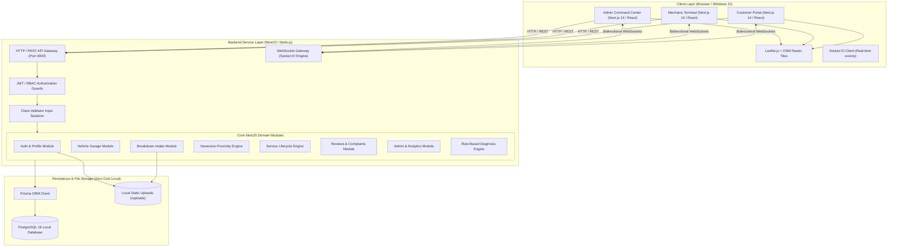
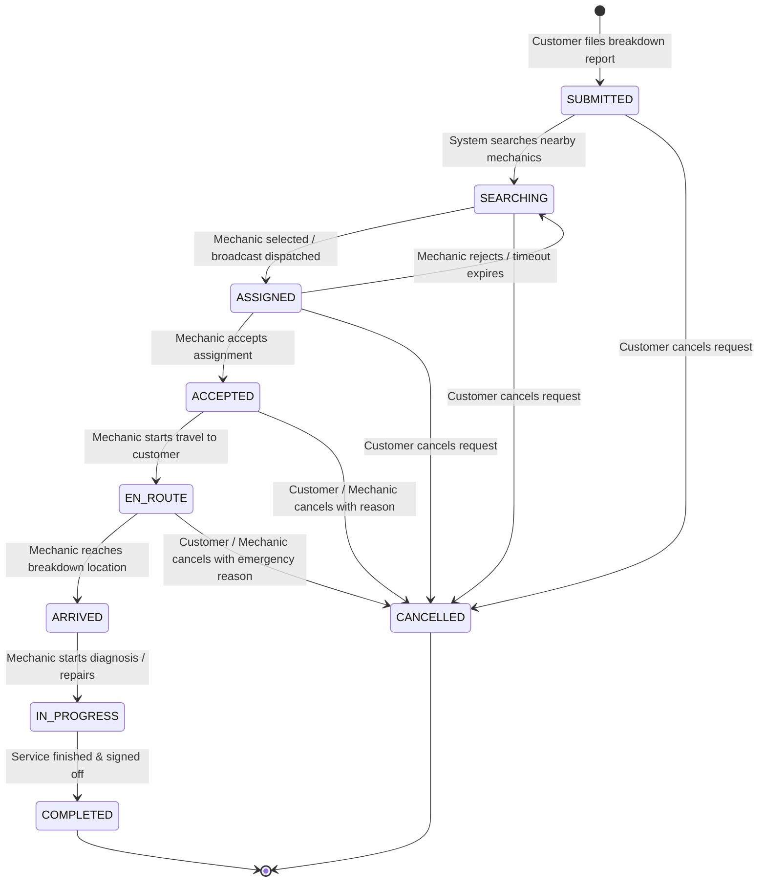
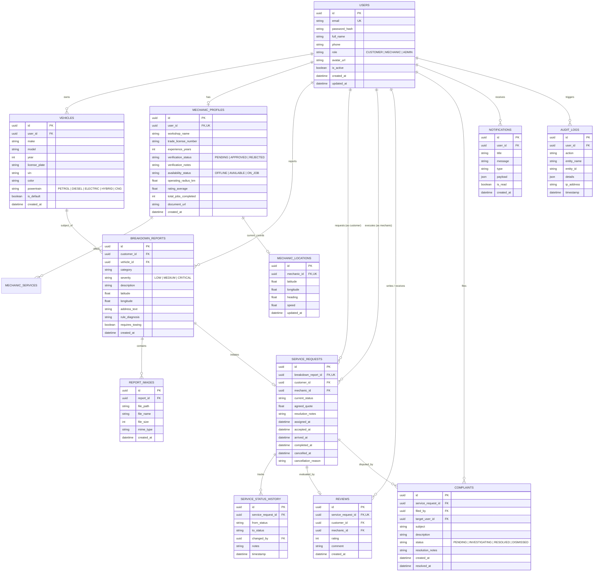

# SYSTEM ARCHITECTURE DOCUMENT

**Project:** Vehicle Breakdown Reporting System (VBRS)  
**Architecture Style:** Modular Monolith / Clean N-Tier Distributed Architecture  
**Document Version:** 1.0.0

---

## 1. System Topology & Physical Architecture



---

## 2. Service Request Lifecycle State Machine

A vehicle breakdown request moves through an explicit, strictly enforced state machine. Invalid state transitions are rejected by the backend with HTTP `400 Bad Request` or `409 Conflict`.



### 2.1 State Transition Validation Matrix
| From State | Allowed Target States | Permitted Roles | Required Conditions |
| :--- | :--- | :--- | :--- |
| `SUBMITTED` | `SEARCHING`, `CANCELLED` | Customer, Admin | Report has valid coordinates & vehicle |
| `SEARCHING` | `ASSIGNED`, `CANCELLED` | System, Customer, Admin | At least one available mechanic found |
| `ASSIGNED` | `ACCEPTED`, `SEARCHING`, `CANCELLED` | Mechanic, Customer, System | Response timeout (60s default) |
| `ACCEPTED` | `EN_ROUTE`, `CANCELLED` | Mechanic, Customer, Admin | Mechanic commits to travel |
| `EN_ROUTE` | `ARRIVED`, `CANCELLED` | Mechanic, Admin | Mechanic GPS indicates proximity |
| `ARRIVED` | `IN_PROGRESS` | Mechanic | On-site inspection commences |
| `IN_PROGRESS` | `COMPLETED` | Mechanic, Customer, Admin | Work performed, summary notes logged |
| `COMPLETED` | *Terminal State* | - | Enables customer review submission |
| `CANCELLED` | *Terminal State* | - | Cancellation reason saved to history |

---

## 3. Database Entity Relationship (ER) Schema

The database model separates the immutable **Breakdown Report** (the physical incident details) from the transient **Service Request** (the operational dispatch and resolution transaction).



---

## 4. Geospatial Proximity Algorithm (Zero-Cost Haversine Engine)

To locate eligible mechanics without paid Google Maps Distance Matrix or proprietary spatial servers, the backend calculates the Great-Circle distance using the Haversine trigonometric formula directly in SQL or TypeScript:

$$\Delta\phi = \phi_2 - \phi_1$$
$$\Delta\lambda = \lambda_2 - \lambda_1$$
$$a = \sin^2\left(\frac{\Delta\phi}{2}\right) + \cos(\phi_1)\cdot\cos(\phi_2)\cdot\sin^2\left(\frac{\Delta\lambda}{2}\right)$$
$$c = 2 \cdot \text{atan2}\left(\sqrt{a}, \sqrt{1-a}\right)$$
$$d = R \cdot c \quad \text{where } R = 6371.0 \text{ km}$$

### SQL Query Implementation Pattern
```sql
SELECT 
    m.id AS mechanic_id,
    u.full_name,
    m.workshop_name,
    m.rating_average,
    loc.latitude,
    loc.longitude,
    (
        6371 * acos(
            cos(radians(:customerLat)) * cos(radians(loc.latitude)) *
            cos(radians(loc.longitude) - radians(:customerLng)) +
            sin(radians(:customerLat)) * sin(radians(loc.latitude))
        )
    ) AS distance_km
FROM "MechanicProfile" m
JOIN "User" u ON m."userId" = u.id
JOIN "MechanicLocation" loc ON m.id = loc."mechanicId"
WHERE m."verificationStatus" = 'APPROVED'
  AND m."availabilityStatus" = 'AVAILABLE'
  AND (
        6371 * acos(
            cos(radians(:customerLat)) * cos(radians(loc.latitude)) *
            cos(radians(loc.longitude) - radians(:customerLng)) +
            sin(radians(:customerLat)) * sin(radians(loc.latitude))
        )
  ) <= m."operatingRadiusKm"
ORDER BY distance_km ASC
LIMIT 10;
```

---

## 5. Real-Time Communication Protocol (Socket.IO)

### Room Structure
- `customer:{customerId}` - Direct alerts to vehicle owners.
- `mechanic:{mechanicId}` - Dispatch requests and job offers to mechanics.
- `request:{requestId}` - Active shared channel for ongoing service engagements between customer and assigned mechanic.
- `admin:monitor` - Platform-wide operational telemetry for the admin dashboard.

### Event Catalog
| Event Name | Direction | Payload Schema | Purpose |
| :--- | :--- | :--- | :--- |
| `mechanic:location_update` | Client -> Server | `{ latitude, longitude, heading, speed }` | Mechanic sends live position |
| `request:status_changed` | Server -> Client | `{ requestId, fromStatus, toStatus, timestamp }` | Broadcasts state changes |
| `mechanic:location_broadcast` | Server -> Client | `{ requestId, latitude, longitude, heading }` | Streams mechanic position to customer |
| `dispatch:incoming` | Server -> Client | `{ requestId, breakdownCategory, distanceKm, vehicleInfo }` | Notifies mechanic of nearby breakdown |
| `dispatch:response` | Client -> Server | `{ requestId, accepted: boolean, reason?: string }` | Mechanic accepts/declines job |

---

## 6. Directory Structure & Monorepo Topology

```
VEHICLE BREAKDOWN SYSTEM/
├── .env.example                     # Root environment variable documentation
├── docker-compose.yml               # Local PostgreSQL 16 container definition
├── README.md                        # Master repository documentation
├── package.json                     # Root orchestration scripts
├── PRODUCT.md                       # Product vision & UX mode definitions
├── DESIGN.md                        # Design system tokens (graphite/slate palette)
├── docs/                            # Comprehensive engineering documentation
│   ├── PROJECT_BLUEPRINT.md
│   ├── PROJECT_STATUS.md
│   ├── ARCHITECTURE.md
│   └── REQUIREMENTS.md
├── backend/                         # NestJS Enterprise API Server
│   ├── package.json
│   ├── tsconfig.json
│   ├── nest-cli.json
│   ├── .env.example
│   ├── prisma/
│   │   ├── schema.prisma            # 14 entities with relations, enums & indexes
│   │   └── seed.ts                  # Seed script for initial admin, test users
│   └── src/
│       ├── main.ts                  # NestJS bootstrap, Swagger, Pipes, CORS
│       ├── app.module.ts            # Root module wiring
│       ├── common/                  # Shared guards, filters, interceptors, pipes
│       │   ├── decorators/
│       │   ├── filters/
│       │   ├── guards/
│       │   └── interceptors/
│       ├── config/                  # Validated configuration service
│       └── modules/                 # Modular domain features
│           ├── prisma/
│           ├── health/
│           ├── auth/
│           ├── users/
│           ├── vehicles/
│           ├── breakdowns/
│           ├── mechanics/
│           ├── requests/
│           ├── realtime/
│           ├── reviews/
│           ├── complaints/
│           ├── admin/
│           └── diagnosis/
└── frontend/                        # Next.js 14 App Router Web Client
    ├── package.json
    ├── tsconfig.json
    ├── next.config.mjs
    ├── tailwind.config.ts           # Graphite/slate theme token configuration
    ├── postcss.config.mjs
    ├── .env.example
    └── src/
        ├── app/                     # App router pages & layouts
        │   ├── layout.tsx
        │   ├── page.tsx             # Professional landing page
        │   ├── (auth)/              # Login, register, forgot-password
        │   ├── customer/            # Customer portal routes
        │   ├── mechanic/            # Mechanic terminal routes
        │   └── admin/               # Admin command center routes
        ├── components/              # Shared UI design system components
        │   ├── ui/                  # Buttons, cards, modals, skeletons, badges
        │   ├── maps/                # Leaflet map container & marker overlays
        │   └── shared/              # Navbar, sidebar, notifications
        ├── lib/                     # API client, Socket client, utilities
        └── types/                   # Shared TypeScript interfaces
```
