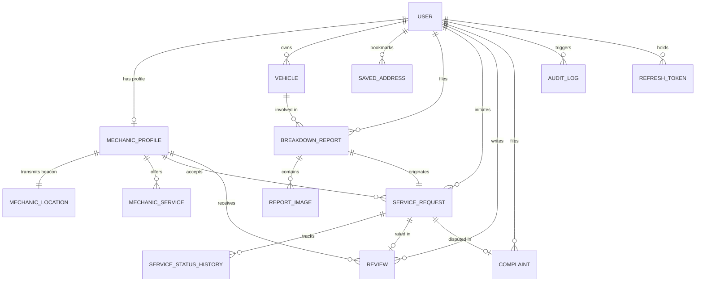

# VEHICLE BREAKDOWN REPORTING & RESPONSE SYSTEM (VBRS)
# Comprehensive Database Architecture & Schema Documentation

**Database Management System:** PostgreSQL 16 / 18  
**Object-Relational Mapping (ORM):** Prisma ORM 5.14+  
**Target Schema:** `public`  
**Operational Database:** `vbrs_db`  
**Isolated Test Database:** `vbrs_test_db`  
**System Version:** 1.0.0 (Production-Quality Academic Capstone Release)  

---

## 1. Architectural Design & Entity-Relationship Model

The VBRS relational schema models the lifecycle of vehicular emergency assistance, from initial driver garage registration to breakdown dispatch, real-time spatial tracking, work order quotation, Bayesian review scoring, and administrative audit logging.

### Relational Entity-Relationship Diagram (ERD)

---

## 2. Complete PostgreSQL Table Dictionary

### 2.1 Table: `User`
Stores core identity, credentials, roles, and status for all system actors.

| Column | Type | Constraints | Description |
| :--- | :--- | :--- | :--- |
| `id` | `UUID` | Primary Key, `gen_random_uuid()` | Unique immutable system identifier. |
| `email` | `VARCHAR(255)` | Unique, Not Null | Normalized login email address. |
| `passwordHash` | `VARCHAR(255)` | Not Null | Bcrypt hashed password (12 rounds). |
| `fullName` | `VARCHAR(255)` | Not Null | Legal full name or registered display identity. |
| `phone` | `VARCHAR(50)` | Nullable | Primary contact telephone. |
| `role` | `ENUM` | Not Null, Default: `CUSTOMER` | Role: `CUSTOMER`, `MECHANIC`, `ADMIN`. |
| `avatarUrl` | `VARCHAR(512)` | Nullable | Optional remote profile image URI. |
| `isActive` | `BOOLEAN` | Not Null, Default: `true` | Administrative account suspension flag. |
| `createdAt` | `TIMESTAMP` | Not Null, Default: `NOW()` | Record initialization timestamp. |
| `updatedAt` | `TIMESTAMP` | Not Null | Last modification timestamp. |

---

### 2.2 Table: `MechanicProfile`
Professional workshop dossier, state licensing, and availability state.

| Column | Type | Constraints | Description |
| :--- | :--- | :--- | :--- |
| `id` | `UUID` | Primary Key, `gen_random_uuid()` | Unique mechanic profile identifier. |
| `userId` | `UUID` | Unique, Foreign Key $\to$ `User.id` (`CASCADE`) | 1-to-1 association with mechanic user account. |
| `workshopName` | `VARCHAR(255)` | Not Null | Registered trade name of workshop or mobile unit. |
| `workshopAddress`| `VARCHAR(512)` | Nullable | Physical street address of workshop facility. |
| `bio` | `TEXT` | Nullable | Professional description and service capabilities. |
| `tradeLicenseNumber` | `VARCHAR(100)` | Not Null | State-issued automotive trade license number. |
| `verificationStatus` | `ENUM` | Default: `PENDING` | `PENDING`, `APPROVED`, `REJECTED`. |
| `availabilityStatus` | `ENUM` | Default: `OFFLINE` | `AVAILABLE`, `OFFLINE`. |
| `operatingRadiusKm` | `DOUBLE` | Default: `25.0` | Active geographic dispatch coverage boundary. |
| `ratingAverage` | `DOUBLE` | Default: `5.0` | Bayesian-weighted customer reputation metric. |
| `totalReviews` | `INTEGER` | Default: `0` | Count of verified completed customer reviews. |
| `totalJobsCompleted`| `INTEGER` | Default: `0` | Verified career completed roadside work orders. |
| `certifications` | `TEXT[]` | Default: `{}` | Array of certifications (ASE, Master Tech, etc.). |
| `specializations` | `TEXT[]` | Default: `{}` | Array of technical specialties (Towing, EV, etc.). |

---

### 2.3 Table: `MechanicLocation`
Real-time high-precision GPS coordinates transmitted by active technician beacons.

| Column | Type | Constraints | Description |
| :--- | :--- | :--- | :--- |
| `id` | `UUID` | Primary Key | Location record identifier. |
| `mechanicId` | `UUID` | Unique, Foreign Key $\to$ `MechanicProfile.id` (`CASCADE`) | 1-to-1 association with mechanic. |
| `latitude` | `DOUBLE PRECISION` | Not Null | Latitude coordinate (degrees). |
| `longitude` | `DOUBLE PRECISION` | Not Null | Longitude coordinate (degrees). |
| `accuracy` | `DOUBLE PRECISION` | Default: `5.0` | Hardware GPS horizontal error margin (meters). |
| `updatedAt` | `TIMESTAMP` | Not Null | Timestamp of most recent telemetry beacon. |

---

### 2.4 Table: `Vehicle`
Motorist fleet registry and primary automobile designation.

| Column | Type | Constraints | Description |
| :--- | :--- | :--- | :--- |
| `id` | `UUID` | Primary Key | Vehicle identifier. |
| `userId` | `UUID` | Foreign Key $\to$ `User.id` (`CASCADE`) | Motorist account ownership. |
| `make` | `VARCHAR(100)` | Not Null | Automotive manufacturer (e.g., `BMW`, `Toyota`). |
| `model` | `VARCHAR(100)` | Not Null | Model designation (e.g., `M4 Competition`). |
| `year` | `INTEGER` | Not Null | Year of production. |
| `licensePlate` | `VARCHAR(50)` | Not Null | Monospace vehicle registration identifier. |
| `color` | `VARCHAR(50)` | Nullable | Exterior finish. |
| `vin` | `VARCHAR(17)` | Nullable | Vehicle Identification Number. |
| `isPrimary` | `BOOLEAN` | Default: `false` | Primary daily driver flag. |

---

### 2.5 Table: `SavedAddress`
Motorist dispatch bookmarks for rapid emergency intake.

| Column | Type | Constraints | Description |
| :--- | :--- | :--- | :--- |
| `id` | `UUID` | Primary Key | Bookmark identifier. |
| `userId` | `UUID` | Foreign Key $\to$ `User.id` (`CASCADE`) | Owning customer account. |
| `label` | `VARCHAR(100)` | Not Null | Bookmark label (e.g., `Home Garage`, `Office`). |
| `address` | `VARCHAR(512)` | Not Null | Physical street address. |
| `latitude` | `DOUBLE PRECISION` | Not Null | Latitude coordinates. |
| `longitude` | `DOUBLE PRECISION` | Not Null | Longitude coordinates. |
| `isDefault` | `BOOLEAN` | Default: `false` | Default dispatch location flag. |

---

### 2.6 Table: `BreakdownReport`
Emergency incident intake records with fault classification and spatial coordinates.

| Column | Type | Constraints | Description |
| :--- | :--- | :--- | :--- |
| `id` | `UUID` | Primary Key | Breakdown incident identifier. |
| `customerId` | `UUID` | Foreign Key $\to$ `User.id` (`CASCADE`) | Motorist reporting incident. |
| `vehicleId` | `UUID` | Foreign Key $\to$ `Vehicle.id` (`CASCADE`) | Disabled vehicle from garage. |
| `category` | `ENUM` | Not Null | Fault category (`ENGINE_FAILURE`, etc.). |
| `severity` | `ENUM` | Not Null, Default: `MEDIUM` | Severity level (`LOW`, `MEDIUM`, `HIGH`, `CRITICAL`). |
| `description` | `TEXT` | Not Null | Motorist's observed symptoms. |
| `latitude` | `DOUBLE PRECISION` | Not Null | Physical breakdown latitude. |
| `longitude` | `DOUBLE PRECISION` | Not Null | Physical breakdown longitude. |
| `address` | `VARCHAR(512)` | Nullable | Approximated highway marker or street address. |
| `isTowingRequired` | `BOOLEAN` | Default: `false` | Heavy flatbed recovery flag. |

---

### 2.7 Table: `ServiceRequest`
State machine entity governing the lifecycle of roadside dispatches.

| Column | Type | Constraints | Description |
| :--- | :--- | :--- | :--- |
| `id` | `UUID` | Primary Key | Service dispatch identifier. |
| `breakdownReportId`| `UUID` | Unique, Foreign Key $\to$ `BreakdownReport.id` (`CASCADE`) | Associated emergency breakdown. |
| `customerId` | `UUID` | Foreign Key $\to$ `User.id` (`CASCADE`) | Motorist recipient. |
| `mechanicId` | `UUID` | Nullable, Foreign Key $\to$ `MechanicProfile.id` (`SET NULL`) | Responding technician. |
| `currentStatus` | `ENUM` | Default: `SUBMITTED` | `SUBMITTED`, `ASSIGNED`, `ACCEPTED`, `EN_ROUTE`, `ARRIVED`, `IN_PROGRESS`, `COMPLETED`, `CANCELLED`. |
| `quotationDiagnostic` | `DECIMAL(10,2)`| Nullable | Authorized diagnostic intake fee. |
| `quotationLabor` | `DECIMAL(10,2)`| Nullable | Recorded mechanical labor cost. |
| `quotationParts` | `DECIMAL(10,2)`| Nullable | Itemized hardware components cost. |
| `quotationTotal` | `DECIMAL(10,2)`| Nullable | Calculated sum of diagnostic, labor, and parts. |
| `locationConsent` | `BOOLEAN` | Default: `true` | Motorist privacy consent for live GPS tracking. |
| `requestedAt` | `TIMESTAMP` | Default: `NOW()` | Timestamp when dispatch was initialized. |
| `acceptedAt` | `TIMESTAMP` | Nullable | Timestamp when mechanic claimed ticket. |
| `enRouteAt` | `TIMESTAMP` | Nullable | Timestamp when technician began driving. |
| `arrivedAt` | `TIMESTAMP` | Nullable | Timestamp when technician reached scene. |
| `inProgressAt` | `TIMESTAMP` | Nullable | Timestamp when repair began. |
| `completedAt` | `TIMESTAMP` | Nullable | Timestamp when work order finalized. |
| `cancelledAt` | `TIMESTAMP` | Nullable | Timestamp if job was cancelled. |
| `cancellationReason` | `TEXT` | Nullable | Recorded justification for cancellation. |

---

### 2.8 Table: `Review`
Verified customer feedback and Bayesian reputation scoring.

| Column | Type | Constraints | Description |
| :--- | :--- | :--- | :--- |
| `id` | `UUID` | Primary Key | Review identifier. |
| `serviceRequestId`| `UUID` | Unique, Foreign Key $\to$ `ServiceRequest.id` (`CASCADE`) | 1-to-1 association with completed dispatch. |
| `customerId` | `UUID` | Foreign Key $\to$ `User.id` (`CASCADE`) | Review author. |
| `mechanicId` | `UUID` | Foreign Key $\to$ `MechanicProfile.id` (`CASCADE`) | Target technician. |
| `rating` | `INTEGER` | Not Null, Range: 1-5 | Overall star rating. |
| `scoreTimeliness` | `INTEGER` | Range: 1-5 | Response speed sub-score. |
| `scoreFairness` | `INTEGER` | Range: 1-5 | Pricing transparency sub-score. |
| `scoreQuality` | `INTEGER` | Range: 1-5 | Technical repair quality sub-score. |
| `comment` | `TEXT` | Nullable | Qualitative motorist feedback. |

---

### 2.9 Table: `AuditLog`
Immutable administrative event log.

| Column | Type | Constraints | Description |
| :--- | :--- | :--- | :--- |
| `id` | `UUID` | Primary Key | Audit log identifier. |
| `userId` | `UUID` | Nullable, Foreign Key $\to$ `User.id` (`SET NULL`) | Operator initiating action. |
| `action` | `VARCHAR(100)` | Not Null | Standardized action keyword (`USER_LOGGED_IN`, etc.). |
| `entityName` | `VARCHAR(100)` | Not Null | Target entity (`User`, `MechanicProfile`, etc.). |
| `entityId` | `VARCHAR(100)` | Nullable | Target record UUID. |
| `details` | `JSONB` | Nullable | Structured before/after state diff metadata. |
| `createdAt` | `TIMESTAMP` | Default: `NOW()` | Immutable timestamp. |

---

## 3. Foreign Key Cascades & Relational Integrity

The schema enforces strict referential integrity across all relationships:
- **Cascade Deletion:** Deleting a `User` cascades cleanly to their `Vehicle`, `SavedAddress`, `RefreshToken`, and `BreakdownReport` records.
- **Set Null Protection:** Deleting a `MechanicProfile` sets `ServiceRequest.mechanicId` to `NULL` to preserve historical roadside service records and legal compliance logs.
- **Relational Integrity Verification:** Confirmed **0 orphan rows** across all relational tables via engine-level SQL foreign-key queries.

---

## 4. Backup & Disaster Recovery Verification

The operational database is protected by automated, verified SQL dump snapshots:
- **Baseline Backup Snapshot:** `scripts/backups/vbrs_db_backup_pre_synthetic_cleanup.sql` (728,403 bytes).
- **Automated Verification Script:** `scripts/test-backup-restore.sh`
  - Restores schema and records into a temporary sandbox database `vbrs_restore_test`.
  - Confirms exact record counts for users, mechanics, and breakdown reports.
  - Verifies foreign key constraints and index integrity before cleanly dropping the test database.
