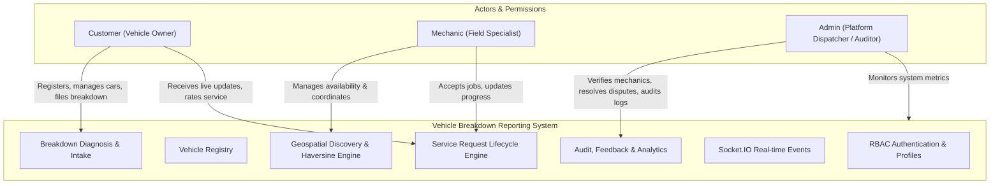

# PROJECT BLUEPRINT: VEHICLE BREAKDOWN REPORTING SYSTEM (VBRS)

**Version:** 1.0.0-PROD  
**Document Author:** Elite Software Engineering Team  
**System Target:** Windows 11 Local Environment & Production-Ready Web Deployment  
**Cost Model:** Zero-Budget ($0.00) / Strict Free & Open-Source Software (FOSS)

---

## 1. Executive Summary & Vision

The **Vehicle Breakdown Reporting System (VBRS)** is an enterprise-grade, mission-critical emergency assistance platform engineered to bridge the immediate gap between distressed vehicle owners and verified, geographically proximate mechanics. When a vehicle experiences a mechanical failure, electrical fault, flat tire, battery discharge, or collision, time and geographic precision are paramount.

Traditional breakdown assistance systems suffer from:
- Opacity in emergency response times and mechanic dispatching.
- Predatory pricing and lack of verified mechanic credentialing.
- Inability to reliably pinpoint exact roadside coordinates without proprietary paid infrastructure.
- Monolithic, non-auditable operational workflows.

VBRS solves these challenges through a modern, reactive distributed architecture built entirely on open-source, zero-cost technologies. The system provides real-time bidirectional geospatial discovery, status tracking, automated rule-based incident classification, and comprehensive administrative oversight without incurring any recurring API fees or subscription lock-in.

---

## 2. Core Operational Persona & Role Definitions

### 2.1 Customer (Vehicle Owner)
- **Identity & Profiles:** Authentication via secure JWT with refresh tokens, personal profile management, and emergency contact details.
- **Vehicle Garage:** CRUD management of customer vehicles (Make, Model, Year, Plate Number, VIN, Fuel/Powertrain Type, Color).
- **Incident Reporting:** Visual and structured breakdown intake:
  - Categorization (Engine, Transmission, Electrical, Tire/Wheel, Battery, Fuel/Fluid, Brake, Collision/Tow).
  - Severity level (Low, Medium, Critical/Immediate Danger).
  - Multi-image photo upload (stored locally on disk with strict MIME/size validation).
  - Precise roadside location capture using HTML5 Geolocation API with manual drag-and-drop Leaflet map pin fallback.
  - Descriptive symptoms and rule-based diagnostic guidance.
- **Service Request & Live Tracking:**
  - Automated radial search for nearby active, verified mechanics.
  - Live state progression tracking (SUBMITTED -> SEARCHING -> ASSIGNED -> ACCEPTED -> EN_ROUTE -> ARRIVED -> IN_PROGRESS -> COMPLETED).
  - Real-time location beaconing of en-route mechanics via WebSockets.
- **Post-Service Resolution:**
  - Rating, multi-criteria feedback (timeliness, professionalism, pricing fairness).
  - Grievance and formal complaint filing with evidence attachments.

### 2.2 Mechanic (Automotive Field Specialist)
- **Professional Onboarding:** Specialized registration requiring identity verification, trade license/certification uploads, business/workshop name, and selected service competencies.
- **Availability & Telemetry Management:**
  - Real-time toggle (`ONLINE`, `OFFLINE`, `ON_JOB`).
  - Active coordinate streaming (`latitude`, `longitude`, `accuracy`, `timestamp`) saved to `mechanic_locations`.
  - Max operating radius configuration (in kilometers).
- **Job Dispatch Radar:**
  - Audible and visual dispatch notifications for incoming requests within service radius.
  - Breakdown snapshot preview: vehicle details, reported faults, photos, and distance.
  - Accept or reject capability with configurable response timeouts.
- **Service Execution Workflow:**
  - Step-by-step state transition triggers: `EN_ROUTE` -> `ARRIVED` -> `IN_PROGRESS` -> `COMPLETED`.
  - Customer phone/direct contact access during active engagements.
  - Completion notes, recommended follow-ups, and cost breakdown logging.
  - Historical ledger of completed jobs and accumulated customer ratings.

### 2.3 Platform Administrator (Dispatcher & Auditor)
- **Supervisory Dashboard:** High-level metrics: total active breakdowns, average dispatch time, mechanic saturation by zone, resolution success rate.
- **Credential Verification Gate:** Detailed review queue of pending mechanic registrations, document verification, approval, rejection, or revocation of operational privileges.
- **System-Wide Incident Management:** Live overview of all active breakdowns; ability to intervene, re-route, or manually assign unserviced requests.
- **Dispute & Grievance Resolution:** Investigation workflow for customer complaints with mechanic counter-evidence and resolution tracking.
- **Immutable Audit Logging:** System-wide logging of all auth events, role changes, state transitions, administrative actions, and sensitive data modifications.

---

## 3. Technology Stack & Architecture Justification

| Layer | Selected Technology | Version / Spec | Justification & Zero-Cost Rationale |
| :--- | :--- | :--- | :--- |
| **Frontend Framework** | **Next.js (App Router)** | 14+ / React 18+ | High-performance React server components, hybrid static/client rendering, file-based routing, SEO-ready metadata. |
| **Language** | **TypeScript** | 5.3+ | End-to-end strict static type safety across frontend and backend contract interfaces. |
| **Styling & Motion** | **Tailwind CSS + Framer Motion** | 3.4+ / 11+ | Utility-first responsive styling adhering to graphite/slate automotive aesthetics; performant hardware-accelerated micro-interactions. |
| **Icons & UI** | **Lucide React + Headless UI** | Latest | High-contrast, clean automotive and diagnostic iconography; accessible zero-dependency primitives. |
| **Backend Framework**| **NestJS** | 10.x | Enterprise modular TypeScript architecture with built-in dependency injection, validation pipes, interceptors, and Swagger integration. |
| **Database** | **PostgreSQL** | 16.x | Robust ACID-compliant relational engine. Runs locally via Docker or local service at zero cost. |
| **ORM & Migrations** | **Prisma ORM** | 5.x / 6.x | Type-safe schema definition, automated SQL migrations, relations, and index management. |
| **Real-time Protocol** | **Socket.IO** | 4.x | Bidirectional, low-latency WebSocket communication with automatic fallback to HTTP long-polling. |
| **Mapping & GIS** | **Leaflet + OpenStreetMap** | Leaflet 1.9+ | 100% free, license-compliant slippy map tiles (CartoDB Positron / OSM default tiles) with client-side caching & offline placeholder grid fallback. |
| **Location Engine** | **HTML5 Geolocation + Haversine SQL** | Native Browser | High-accuracy device GPS with manual interactive pin fallback; zero-cost mathematical spherical trigonometry distance computation. |
| **API Docs** | **Swagger / OpenAPI 3.0** | Native NestJS | Auto-generated interactive API contracts accessible at `/api/docs`. |
| **Testing Suite** | **Vitest / Jest + Playwright** | Latest | Vitest/Jest for fast unit/integration testing; Playwright for end-to-end user journey simulation. |

---

## 4. Zero-Cost Implementation Matrix

To adhere strictly to the non-negotiable constraint of **Zero Budget, No Paid APIs, and No Subscriptions**, the engineering architecture enforces the following implementation choices:

1. **Mapping Without Google Maps / Mapbox APIs:**
   - Client maps are rendered using **Leaflet.js** utilizing **OpenStreetMap standard raster tiles** or CartoDB neutral tiles adhering strictly to OSM Tile Usage Policies (including user-agent identification and client-side caching).
   - If network connectivity is degraded or tiles are unreachable, the UI gracefully renders a high-contrast coordinate grid with manual latitude/longitude entry and directional vector distance indicators.
2. **Reverse Geocoding Without Paid Geocoders:**
   - Primary: Uses Nominatim OpenStreetMap search API with rate-limiting and cache headers, or falls back to human-readable landmark selection and manual street name entry.
3. **Geospatial Distance Querying Without PostGIS Extensions:**
   - Implements the mathematical **Haversine Great-Circle Distance formula** directly in PostgreSQL SQL queries and backend services. This ensures universal portability across standard PostgreSQL installations without requiring proprietary or custom spatial libraries:
   $$d = 2r \arcsin\left(\sqrt{\sin^2\left(\frac{\Delta\phi}{2}\right) + \cos(\phi_1)\cos(\phi_2)\sin^2\left(\frac{\Delta\lambda}{2}\right)}\right)$$
4. **Local Multi-Part File Storage:**
   - Multi-image uploads (breakdown damage, mechanic trade licenses) are validated on the server for MIME type (`image/jpeg`, `image/png`, `image/webp`), size limits (max 5MB per file), and magic bytes, then written to a secured local volume (`uploads/`) and served through static NestJS asset endpoints with cache headers.
5. **Rule-Based Intelligent Diagnosis (Zero-Cost AI Alternative):**
   - Implements a deterministic, expert-system rule engine evaluating customer-reported symptoms, vehicle telemetry, warning light indicators (CEL, oil pressure, battery voltage, ABS), and ambient conditions.
   - Outputs: Predicted failure domain, estimated roadside repair feasibility vs. flatbed towing necessity, safety urgency level, and suggested tool/part requirements for dispatch.

---

## 5. Security & Defense-in-Depth Specification

- **Authentication & RBAC:**
  - Passwords hashed using `bcrypt` (12 salt rounds).
  - Stateless JWT access tokens (short TTL, e.g., 15m) paired with encrypted, httpOnly refresh token cookies.
  - Role-Based Access Control guards applied at controller and method levels (`@Roles('ADMIN')`, `@Roles('MECHANIC')`, `@Roles('CUSTOMER')`).
- **Input Sanitization & Validation:**
  - Class-validator and class-transformer on every NestJS DTO with strict whitelist filters, stripping undeclared payload properties.
  - SQL injection prevention guaranteed via Prisma parameterized queries.
  - Cross-Site Scripting (XSS) mitigated by React DOM escaping and strict CSP headers via Helmet.
- **File Upload Hardening:**
  - Randomized UUID file naming prevents path traversal attacks (`../../`).
  - Validation of file extensions against actual file byte signatures.
- **Audit Logging:**
  - Centralized `AuditLog` database table tracking actor ID, action type, IP address, user-agent, target entity, and timestamp.

---

## 6. Milestone Delivery Roadmap

- **Milestone 1 (M1) - Foundation & Database Architecture:**
  - Architecture blueprint, requirements SRS, status tracking, and Impeccable design system tokens.
  - Monorepo/project structure initialization (NestJS backend, Next.js frontend, Docker Compose Postgres).
  - Prisma schema with all 14 entities, migrations, and seed script.
  - Health checks, Swagger docs, Tailwind graphite/slate theme setup.
- **Milestone 2 (M2) - Auth, RBAC, Profiles & Garage:**
  - Registration/login flows for Customer, Mechanic, and Admin.
  - JWT auth, refresh token rotation, password hashing, and user profile updates.
  - Customer vehicle management (CRUD with validation).
- **Milestone 3 (M3) - Breakdown Intake & Location Services:**
  - Breakdown reporting multi-step wizard.
  - Leaflet map integration with GPS geolocation and pin-drop fallback.
  - Multi-image secure upload pipeline and preview gallery.
- **Milestone 4 (M4) - Mechanic Portal & Geospatial Discovery:**
  - Mechanic availability toggle and real-time coordinate beaconing.
  - Haversine proximity query engine finding active mechanics within radius.
  - Mechanic service category configuration and credential document submission.
- **Milestone 5 (M5) - Dispatch, WebSockets & Live Tracking:**
  - Service request lifecycle engine with validated state machine.
  - Socket.IO gateway with bidirectional rooms (`request_{id}`, `mechanic_{id}`, `customer_{id}`).
  - Real-time driver en-route tracking on interactive Leaflet map.
- **Milestone 6 (M6) - Administration, Moderation & Analytics:**
  - Admin dashboard with real-time incident counters and mechanic verification desk.
  - Re-assignment tools and customer complaint resolution pipeline.
  - Analytics reporting using pure SQL aggregations and Recharts visual metrics.
- **Milestone 7 (M7) - Expert Rule-Based Diagnosis & Review System:**
  - Decision-tree breakdown classifier (predicting tow necessity vs roadside repair).
  - Customer review submission with multi-axis metrics.
  - Mechanic reputation scoring algorithm.
- **Milestone 8 (M8) - Verification, Hardening, Docs & Demonstration:**
  - Comprehensive unit, integration, and E2E test execution.
  - Security audit and penetration check pass.
  - Full project documentation compilation for academic/commercial evaluation.
